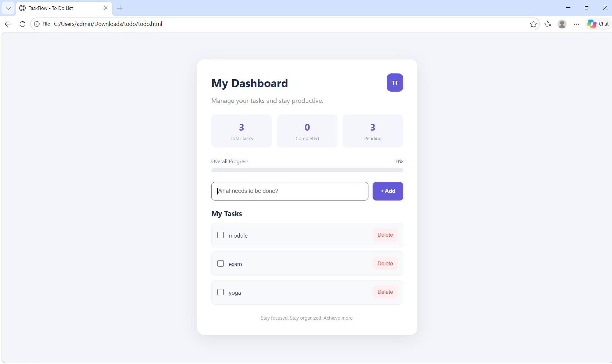

# Ex03 To-Do List using JavaScript
## Date:17-11-2026

## AIM
To create a To-do Application with all features using JavaScript.

## ALGORITHM
### STEP 1
Build the HTML structure (index.html).

### STEP 2
Style the App (style.css).

### STEP 3
Plan the features the To-Do App should have.

### STEP 4
Create a To-do application using Javascript.

### STEP 5
Add functionalities.

### STEP 6
Test the App.

### STEP 7
Open the HTML file in a browser to check layout and functionality.

### STEP 8
Fix styling issues and refine content placement.

### STEP 9
Deploy the website.

### STEP 10
Upload to GitHub Pages for free hosting.

## PROGRAM

```

<!DOCTYPE html>
<html>
<head>
    <title>TaskFlow - To Do List</title>

    <style>
        * {
            margin: 0;
            padding: 0;
            box-sizing: border-box;
        }

        body {
            font-family: 'Segoe UI', Arial, sans-serif;
            background: #f3f5fa;
            min-height: 100vh;
            display: flex;
            justify-content: center;
            align-items: center;
            padding: 20px;
        }

        .dashboard {
            width: 550px;
            background: white;
            padding: 35px;
            border-radius: 18px;
            box-shadow: 0 10px 40px rgba(0,0,0,0.08);
        }

        .header {
            display: flex;
            justify-content: space-between;
            align-items: center;
            margin-bottom: 10px;
        }

        .header h1 {
            color: #202b45;
            font-size: 28px;
        }

        .logo {
            background: #635bdb;
            color: white;
            padding: 12px;
            border-radius: 12px;
            font-weight: bold;
        }

        .subtitle {
            color: #8991a4;
            margin-bottom: 25px;
        }

        .stats {
            display: flex;
            gap: 12px;
            margin-bottom: 25px;
        }

        .stat-box {
            flex: 1;
            background: #f5f6fc;
            padding: 15px 8px;
            border-radius: 12px;
            text-align: center;
        }

        .stat-box h2 {
            color: #635bdb;
            font-size: 24px;
        }

        .stat-box p {
            color: #8991a4;
            font-size: 12px;
            margin-top: 5px;
        }

        .progress-section {
            margin-bottom: 25px;
        }

        .progress-text {
            display: flex;
            justify-content: space-between;
            color: #4b556b;
            font-size: 13px;
            margin-bottom: 10px;
        }

        .progress-bar {
            height: 9px;
            background: #e9eaf2;
            border-radius: 10px;
            overflow: hidden;
        }

        .progress {
            height: 100%;
            width: 0%;
            background: linear-gradient(90deg, #635bdb, #9b7af5);
            transition: width 0.3s;
        }

        .input-section {
            display: flex;
            gap: 10px;
            margin-bottom: 20px;
        }

        input {
            flex: 1;
            padding: 14px;
            border: 1px solid #e1e4ed;
            border-radius: 9px;
            outline: none;
            font-size: 14px;
        }

        input:focus {
            border-color: #635bdb;
        }

        .add-btn {
            background: #635bdb;
            color: white;
            border: none;
            padding: 13px 20px;
            border-radius: 9px;
            cursor: pointer;
            font-weight: bold;
        }

        .add-btn:hover {
            background: #4c45b9;
        }

        .task-heading {
            color: #202b45;
            font-size: 18px;
            margin-bottom: 12px;
        }

        ul {
            list-style: none;
        }

        li {
            display: flex;
            align-items: center;
            justify-content: space-between;
            background: #f8f9fd;
            border: 1px solid #edf0f5;
            padding: 14px;
            border-radius: 10px;
            margin-bottom: 10px;
            gap: 10px;
        }

        .task-content {
            display: flex;
            align-items: center;
            gap: 12px;
            flex: 1;
            min-width: 0;
        }

        .task-content span {
            overflow-wrap: anywhere;
            color: #344054;
            font-size: 14px;
        }

        .task-content span.completed {
            text-decoration: line-through;
            color: #a0a5b1;
        }

        .task-content input {
            flex: none;
            width: 17px;
            height: 17px;
            accent-color: #635bdb;
            cursor: pointer;
        }

        .delete-btn {
            background: #fff0f0;
            color: #e5484d;
            border: none;
            padding: 8px 11px;
            border-radius: 7px;
            cursor: pointer;
        }

        .delete-btn:hover {
            background: #e5484d;
            color: white;
        }

        .empty {
            text-align: center;
            color: #a0a5b1;
            padding: 25px 5px;
            font-size: 14px;
        }

        .footer {
            text-align: center;
            color: #a0a5b1;
            font-size: 12px;
            margin-top: 25px;
        }

        @media(max-width: 500px) {
            .dashboard {
                padding: 22px;
            }

            .header h1 {
                font-size: 23px;
            }

            .stats {
                gap: 7px;
            }
        }
    </style>
</head>

<body>

    <div class="dashboard">

        <div class="header">
            <h1>My Dashboard</h1>
            <div class="logo">TF</div>
        </div>

        <p class="subtitle">Manage your tasks and stay productive.</p>

        <div class="stats">

            <div class="stat-box">
                <h2 id="total">0</h2>
                <p>Total Tasks</p>
            </div>

            <div class="stat-box">
                <h2 id="completed">0</h2>
                <p>Completed</p>
            </div>

            <div class="stat-box">
                <h2 id="pending">0</h2>
                <p>Pending</p>
            </div>

        </div>

        <div class="progress-section">

            <div class="progress-text">
                <span>Overall Progress</span>
                <span id="percentage">0%</span>
            </div>

            <div class="progress-bar">
                <div class="progress" id="progress"></div>
            </div>

        </div>

        <div class="input-section">

            <input type="text" id="taskInput"
                   placeholder="What needs to be done?">

            <button class="add-btn" onclick="addTask()">
                + Add
            </button>

        </div>

        <h3 class="task-heading">My Tasks</h3>

        <ul id="taskList">
        </ul>

        <p class="footer">
            Stay focused. Stay organized. Achieve more.
        </p>

    </div>

    <script>

        function addTask() {

            let input = document.getElementById("taskInput");
            let task = input.value.trim();

            if (task === "") {
                alert("Please enter a task!");
                return;
            }

            let li = document.createElement("li");

            let content = document.createElement("div");
            content.className = "task-content";

            let checkbox = document.createElement("input");
            checkbox.type = "checkbox";

            let span = document.createElement("span");
            span.textContent = task;

            checkbox.onchange = function() {
                span.classList.toggle("completed", checkbox.checked);
                updateStats();
            };

            let deleteBtn = document.createElement("button");
            deleteBtn.textContent = "Delete";
            deleteBtn.className = "delete-btn";

            deleteBtn.onclick = function() {
                li.remove();
                updateStats();
            };

            content.appendChild(checkbox);
            content.appendChild(span);

            li.appendChild(content);
            li.appendChild(deleteBtn);

            document.getElementById("taskList").appendChild(li);

            input.value = "";

            updateStats();
        }

        function updateStats() {

            let tasks = document.querySelectorAll("#taskList li");

            let total = tasks.length;

            let completed = document.querySelectorAll(
                "#taskList input:checked"
            ).length;

            let pending = total - completed;

            let percentage = total === 0
                ? 0
                : Math.round((completed / total) * 100);

            document.getElementById("total").textContent = total;

            document.getElementById("completed").textContent = completed;

            document.getElementById("pending").textContent = pending;

            document.getElementById("percentage").textContent =
                percentage + "%";

            document.getElementById("progress").style.width =
                percentage + "%";
        }

        document.getElementById("taskInput").addEventListener(
            "keydown", function(event) {
                if (event.key === "Enter") {
                    addTask();
                }
            }
        );

    </script>

</body>
</html>

```


## OUTPUT




## RESULT
The program for creating To-do list using JavaScript is executed successfully.